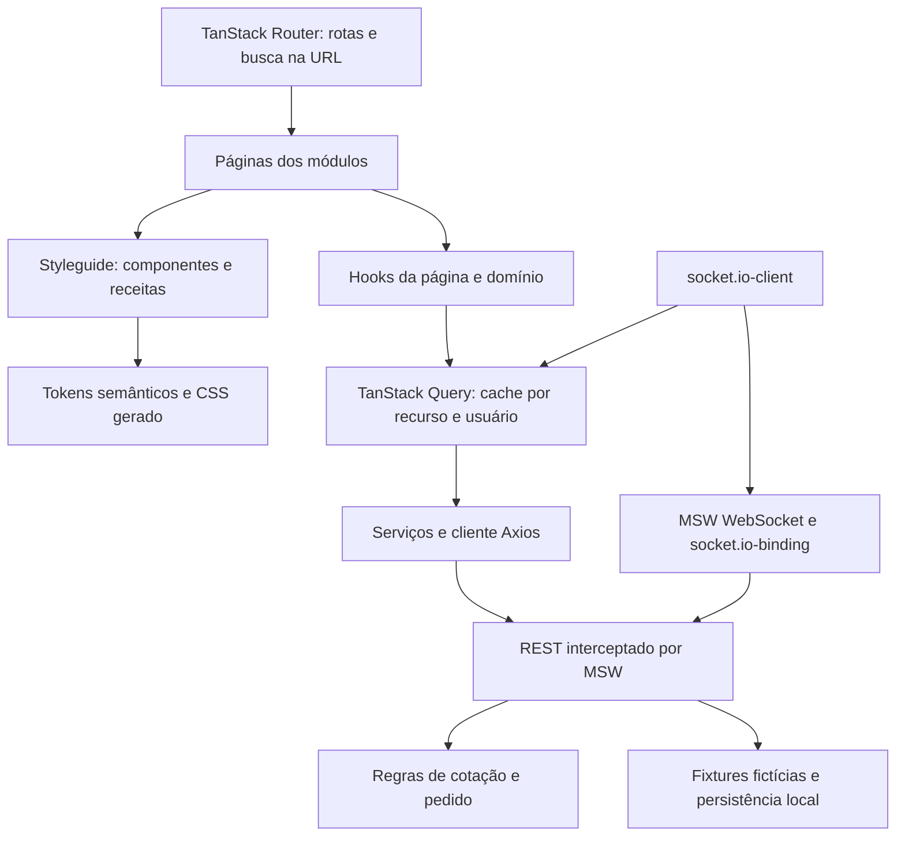
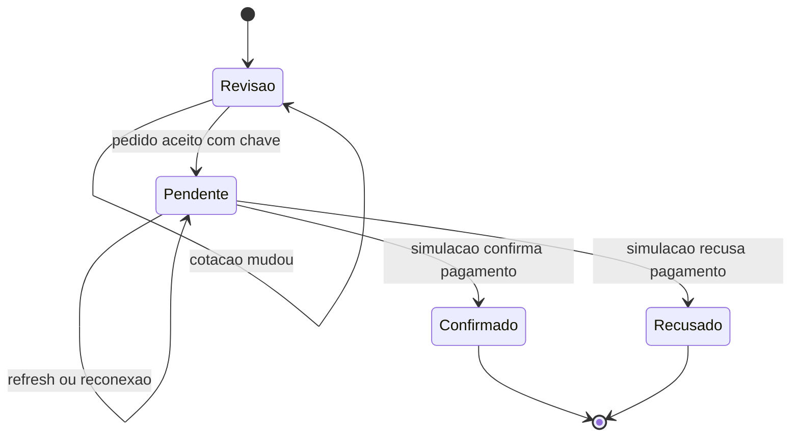
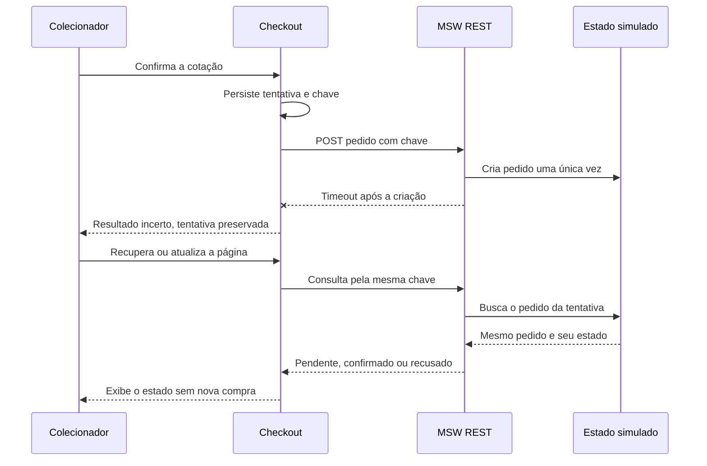

# Arquitetura e decisões

## Objetivo e fronteiras

KURIO é uma aplicação de demonstração para o desafio Jungle. A interface percorre os mesmos contratos HTTP que seriam consumidos de um backend. MSW intercepta essa rede e mantém uma simulação persistente. Nenhum serviço de produção ou dado privado é necessário.

A organização segue a convenção solicitada: `modules/<dominio>/pages/<Pagina>/index.tsx` compõe a tela, o hook próximo da página concentra estado e operações, e `components/<Nome>/index.tsx` contém a apresentação reutilizável. `shared-types.ts` reúne os tipos de composição do módulo; `contracts.ts` define os modelos de transporte. Algumas fachadas em `lib/` e `components/ui/` preservam imports públicos enquanto a implementação é organizada em serviços e styleguide.

## Styleguide

Os tokens definem o vocabulário visual e os aliases semânticos. As receitas definem variações de componentes, como botões. O gerador transforma essa fonte em CSS usado no desenvolvimento e no build; não é necessário transcrever cores em cada tela.

As primitivas seguem o padrão de composição shadcn/ui, com Radix para slots e diálogos e CVA para variantes. Diálogos usam semântica, contenção e retorno de foco da primitiva. Os campos mantêm labels, estados de erro e foco visível. Skeletons reservam dimensões e respeitam movimento reduzido.

### Tema Kurio e estado da interface

`theme/index.ts` expõe apenas `kurio`. O gerador emite as variáveis usadas por `data-theme`, e o `StyleguideProvider` distribui tokens e aliases semânticos por React Context. Preferências antigas ou inválidas são normalizadas para Kurio, inclusive quando o armazenamento está bloqueado. Não há alternância pública entre aparências nesta revisão.

Zustand mantém somente o identificador da obra aberta na prévia global. O conteúdo e o estado do servidor pertencem ao TanStack Query; carrinho, sessão, preço e estoque não são duplicados na store de interface. O destaque e os cards recebem assets responsivos de um mapa de apresentação, sem carregar fixtures de negócio nos componentes.

## Contratos REST

Todas as chamadas da interface passam pelo cliente Axios. Respostas de erro usam `{ message, code }` e o status HTTP correspondente. O modelo de erro representa validação, sessão expirada, recurso inexistente, conflito de disponibilidade e indisponibilidade transitória.

| Recurso                              | Contrato                                                                                                           |
| ------------------------------------ | ------------------------------------------------------------------------------------------------------------------ |
| `GET /api/nfts`                      | `q`, `category`, `sort`, `page`, `minPrice`, `maxPrice`, `network`, `tab`; resposta com itens, paginação e facetas |
| `GET /api/nfts/:id`                  | Detalhe tipado; 404 para identificador inexistente                                                                 |
| `GET /api/recommendations`           | Exclusões e limite; itens selecionados por popularidade fictícia, com critério e `simulated: true`                 |
| `GET /api/articles`                  | Quatro previews ilustrativos do Diário da Cunhagem                                                                 |
| `GET /api/articles/:id`              | Conteúdo demonstrativo e 404 para artigo inexistente                                                               |
| `POST /api/newsletter/subscriptions` | E-mail normalizado; inscrição local idempotente, sem envio real                                                    |
| `GET /api/session`                   | Usuário público ou `null`                                                                                          |
| `POST /api/session/login`            | E-mail e senha fictícios; sessão e merge do carrinho visitante                                                     |
| `POST /api/session/register`         | Nome, e-mail e senha; conflito para conta já existente                                                             |
| `POST /api/session/logout`           | Encerramento da sessão                                                                                             |
| `GET/POST /api/favorites`            | Leitura e atualização da intenção de favorito                                                                      |
| `GET /api/cart`                      | Itens, NFT atual e versão do carrinho                                                                              |
| `POST /api/cart/items`               | NFT, edição opcional e quantidade inteira                                                                          |
| `PATCH/DELETE /api/cart/items/:id`   | Alteração de quantidade ou remoção                                                                                 |
| `POST /api/quote`                    | Cupom opcional; itens, subtotal, desconto, taxa, total, fingerprint e expiração                                    |
| `POST /api/orders`                   | Cotação, chave de idempotência, carteira, rede e dados fictícios do colecionador                                   |
| `GET /api/orders/:id`                | Estado e snapshot de um pedido pertencente à sessão                                                                |
| `GET /api/orders/attempt/:key`       | Recuperação da tentativa pelo usuário autenticado                                                                  |
| `GET/PATCH /api/profile`             | Leitura e edição dos campos públicos do perfil                                                                     |
| `POST /api/profile/password`         | Senha atual e nova senha, apenas na simulação                                                                      |
| `GET/POST /api/wallets`              | Cadastro e edição de carteira, rede e preferência principal                                                        |
| `POST /api/demo/scenario`            | Seleção de cenário determinístico de rede ou pagamento                                                             |
| `POST /api/demo/reset`               | Restauração integral das fixtures                                                                                  |
| `POST /api/demo/nft-update`          | Alteração de preço e publicação do evento correspondente                                                           |

## Recomendações, leitura e newsletter

Recomendações excluem os identificadores fornecidos e ordenam as fixtures por popularidade fictícia, com desempate por ID. O endpoint retorna a descrição do critério e `simulated: true`. A seleção não usa histórico de pessoas, analytics externos ou uma lista de IDs definida pela tela. A ordenação da homepage continua independente desse ranking.

O Diário da Cunhagem preserva os quatro títulos e resumos do template. A listagem retorna previews; a leitura busca o artigo por ID. Os parágrafos explicam que as datas, os tempos de leitura e o conteúdo são exemplos. O título sobre dez artistas não representa uma publicação nem uma recomendação de artistas reais. Não há criação ou edição editorial.

A newsletter valida o e-mail normalizado com limite de 160 caracteres. A primeira inscrição guarda ID e data; repetir o mesmo endereço retorna esses valores com `alreadySubscribed: true`. O dado permanece apenas na simulação local e é removido pelo reset. Não existe endpoint que liste os endereços, integração SMTP ou promessa de envio. O hook preserva o rascunho em falhas e descarta respostas de outra identidade ou época da interface.

## Dinheiro, cotação e pedido

Valores ETH são strings decimais no transporte. Os cálculos usam `BigInt` em wei para evitar arredondamento de ponto flutuante. Quantidades são inteiras, positivas e limitadas pelo estoque.

A cotação identifica o usuário, versão do carrinho, edições, redes, preços, versões dos NFTs, cupom e todos os valores financeiros, incluindo desconto, taxa e total, em um fingerprint. Ela expira em cinco minutos. O checkout busca uma cotação atual antes de criar o pedido; mudança de fingerprint exige revisão e nova confirmação.

O pedido preserva uma cópia da cotação. O recibo usa essa cópia, e não recalcula preços a partir do catálogo. A confirmação remove somente os itens e quantidades adquiridos. Na recusa, o carrinho permanece e o estoque reservado é liberado.

A tentativa é registrada no navegador antes do envio. Repetir a mesma chave e conteúdo recupera o mesmo pedido; reutilizar a chave para outra intenção gera conflito. A transação da simulação serializa alterações de estoque e criação. Essa fila é local à instância do mock: não substitui restrições transacionais de um backend distribuído.

## Cache, cancelamento e sessão

TanStack Query mantém o estado remoto. Chaves incluem parâmetros do catálogo e identidade do usuário quando o recurso é privado. O catálogo usa stale time curto, e mutations invalidam as projeções relacionadas. Favoritos têm atualização otimista e restauração do snapshot em falha.

Consultas canceláveis propagam `AbortSignal` ao Axios. Logout, expiração e troca de usuário cancelam consultas e removem o cache privado. A fronteira de transporte também valida o contexto da sessão para não aceitar uma resposta privada de uma sessão anterior. A sessão pode ser restaurada depois de refresh.

Mutations de compra não têm retry automático. Isso evita transformar uma falha de comunicação em uma nova intenção de compra. Consultas podem repetir uma falha transitória uma vez; erros 4xx não entram no retry geral.

O armazenamento local é permitido para a demonstração e guarda apenas fixtures e dados introduzidos na própria simulação. Um produto real precisaria de autenticação server-side, política de cookies, proteção de credenciais e persistência transacional próprias.

## Socket.IO e reconciliação

O cliente efetivo é `socket.io-client`. O mock usa WebSocket interceptado pelo MSW e `@mswjs/socket.io-binding` para o protocolo. O caminho é `/marketplace-events/` e o transporte é WebSocket-only. O caminho customizado evita o tratamento especial de `/socket.io/` da versão MSW utilizada.

`nft.updated` carrega identidade do evento, NFT e versão. `order.updated` inclui pedido, versão e usuário. O consumidor verifica o contexto da sessão, ignora versões antigas/duplicadas e não permite regredir pedidos terminais. Eventos invalidam consultas; a resposta REST continua sendo a fonte autoritativa.

A reconexão refaz as consultas dos recursos ativos. O ciclo de vida da conexão remove listeners e desconecta ao desmontar ou trocar de usuário. A biblioteca Socket.IO é carregada depois de o MSW instalar a interceptação de WebSocket.

Limites: não há servidor Socket.IO de produção, salas distribuídas, polling de transporte, blockchain ou sincronização entre dispositivos. A persistência mantém a demonstração após refresh no mesmo navegador. Testes de evento devem atravessar o cliente Socket.IO e o binding, não setters da interface.

## Validação adversarial e evidências

A revisão adversarial verificou transporte real, notificações, consistência de cotação, idempotência, quantidades, isolamento de sessão, dados sensíveis e geometria responsiva. Ela encontrou problemas antes da publicação, incluindo conexão de socket inativa e ausência de anúncio visual da alteração de preço. As correções e verificações pertencem aos relatórios em `reports/`.

| Área do enunciado                                  | Estado da implementação e limite de verificação                                                                     |
| -------------------------------------------------- | ------------------------------------------------------------------------------------------------------------------- |
| React, TypeScript, Router, Query, Axios e REST     | Integrados; confirmar execução final de typecheck, lint e testes                                                    |
| Tailwind, primitivas shadcn/Radix e tema           | Integrados e organizados em styleguide                                                                              |
| Catálogo, busca, filtros, ordem e paginação        | Implementados com parâmetros na URL                                                                                 |
| Detalhe, quantidades e favoritos                   | Implementados; galeria com ampliação e enquadramentos, edições com preço e estoque próprios                         |
| Carrinho, cupom e refresh/login                    | Implementados; conferir regressões finais de persistência e estoque                                                 |
| Checkout, carteira, revalidação e idempotência     | Implementados com simulação; não realizam transação real                                                            |
| Login, cadastro, perfil, avatar, senha e carteiras | Implementados; segurança de produção não é alegada                                                                  |
| MSW e cenários de rede/erros                       | Integrados na rede e disponíveis no build de demonstração                                                           |
| Socket.IO e atualização do carrinho                | Conexão e atualização real pela simulação verificadas; consultar regressão final do aviso e demais cenários         |
| E2E e regressão visual                             | Suítes e baselines disponíveis; resultados finais e traces devem acompanhar a entrega                               |
| Acessibilidade                                     | Semântica, labels, teclado, foco de diálogos e movimento reduzido implementados; auditoria completa não certificada |
| Responsividade                                     | Estrutura para desktop/tablet/mobile; teste de overflow em 768 px executado; demais resultados nos relatórios       |
| Lighthouse                                         | Script com três medições por página/perfil e mediana; metas dependem dos valores realmente obtidos                  |
| Figma                                              | Frames, medidas e assets lidos da cópia autorizada; comentários lidos do original; diferenças registradas           |
| Deploy e revisão pública                           | Exigem confirmação da versão publicada e da revisão final; este documento não comprova publicação                   |

## Desvios visuais e privacidade

A cópia fornecida pelo candidato permitiu ler os frames, medidas e assets originais. A implementação usa Roboto Mono local, cores e dimensões extraídas do arquivo. Os PNGs foram deduplicados e convertidos para WebP. Os comentários do original foram lidos no navegador porque a cópia não preservou os tópicos. A matriz de revisão em `docs/figma-comments-review.json` distingue defeitos apontados de sugestões sem aprovação. Não se declara fidelidade de 100%: dados dinâmicos, correção de totais e adaptações sem frame exigem avaliação humana.

A entrega não contém dumps, cookies de teste reais, registros de clientes, documentos clínicos, dados financeiros nem credenciais de projetos anteriores. As contas usam o domínio reservado `example.test`. A validação de segredos e do pacote final deve acompanhar a publicação, sem confundir ausência de alerta automático com prova absoluta de ausência de dado sensível.

## Responsabilidades e hooks

`useMarketplace` compõe a busca da URL e as operações do catálogo. `useNftDetails` concentra edição, quantidade, inclusão e favorito; `NftGallery` mantém somente seleção de enquadramento e ampliação. `useCartPage` controla cupom e comandos do carrinho. `useCheckoutFields` mantém o rascunho por identidade; `useCheckout` coordena conexão simulada, revisão, tentativa e recuperação. Componentes de formulário recebem valores e comandos tipados.

`QuantityInput` compartilha os limites e o comportamento entre detalhe e carrinho. `CartItemRow`, `CartSummary`, `CollectorForm` e `OrderReceipt` separam apresentação dos respectivos fluxos. `RelatedNfts` consulta o endpoint de recomendações com os itens a excluir e recebe também a descrição do critério simulado. `useAddToCart` compartilha as guardas de proprietário e invalidação entre card, prévia e detalhe.

A responsabilidade única aparece nessas fronteiras, e a inversão de dependência ocorre entre telas e contratos de serviço. Não há uma interface abstrata para cada função: os pontos de substituição necessários são a rede, os contratos e as primitivas. A aplicação continua pequena o suficiente para seguir as dependências diretamente.

## Edições e snapshot

Cada obra oferece edições identificadas por `one-of-one`, `one-of-ten`, `one-of-fifty` e `open`. Preço e estoque pertencem à edição. O carrinho usa uma identidade própria por variante; alterar ou excluir uma não modifica a outra. Reservas ocorrem uma vez na criação do pedido; a recusa libera exatamente a variante reservada. O recibo preserva preço, quantidade, edição, token e metadados históricos disponíveis.

As miniaturas representam enquadramentos da mesma imagem, pois o arquivo não fornece quatro obras distintas para a galeria. A seleção da edição é um controle separado e altera os valores efetivos. Essa distinção responde à dúvida do comentário 23 sem inventar assets ou uma associação ausente no enunciado.

## Validação de isolamento

O transporte captura a geração da sessão e uma época local no instante da chamada, antes de qualquer espera assíncrona. O backend simulado rejeita uma geração antiga. A época impede aceitar respostas anteriores a uma transição de conta ou reset, mesmo quando o número da geração é reutilizado. Se apenas o armazenamento da base for recriado, uma resposta atual pode reconciliar a geração menor; uma resposta em voo de outra época continua descartada. O fallback em memória preserva esse controle quando sessionStorage está bloqueado. Hooks também capturam o proprietário da operação e conferem a sessão antes de enviar e antes de atualizar o cache. A revisão reproduziu alterações de perfil e favoritos atravessando a troca de conta; os testes de regressão verificam que essas operações são descartadas.

Falhas de transporte durante uma compra podem deixar o resultado incerto. A tentativa persiste antes do envio, e a recuperação consulta a mesma chave. Apenas a confirmação autoritativa altera o fluxo para comprovante. Os comentários no código ficam restritos a esses invariantes e a detalhes críticos do transporte e da precisão numérica.

## Carregamento e desempenho

O bootstrap inicia os módulos em paralelo e cria uma única raiz React para os placeholders e o aviso visível de carregamento. Essa composição inicial não importa Router, Query, serviços ou mocks. A aplicação com consultas e Socket.IO substitui os placeholders somente depois de worker.start concluir. A rota de detalhe pode antecipar o download de seu módulo sem executar consultas antes dessa barreira.

Após a interceptação estar pronta, a inicialização antecipa somente as consultas públicas de catálogo ou NFT da URL atual. As mesmas factories de queryOptions são usadas pelos hooks, com os mesmos parâmetros, chaves, sinais de cancelamento e políticas de cache. O cliente deduplica a consulta em andamento; o preload não insere fixtures nem inventa respostas. As imagens retornadas pela API recebem hints com os mesmos srcSet e sizes da apresentação. Erros, resultado vazio e recurso inexistente permanecem no fluxo normal de Query e da interface.

A fonte é servida localmente. As quatro primeiras imagens do catálogo recebem prioridade, pois a medição identificou uma delas como LCP dentro do viewport mobile. As demais continuam sob demanda, com dimensões explícitas. O mapa de apresentação seleciona variantes de 360, 600 ou 900 pixels conforme o espaço e a densidade; o destaque também oferece a variante mobile de 300 pixels. A galeria usa variantes responsivas e miniaturas lazy. Seu skeleton é compartilhado entre a espera da rota e a consulta: mantém toolbar, galeria, informações e seções inferiores para preservar o espaço do conteúdo. A decoração do destaque reproduz o SVG original inline; o SVG desktop vazio não produz conteúdo e foi retirado da árvore. Nenhuma arte foi simplificada para a auditoria. A medição final usa o mesmo build e o mesmo cenário da entrega. O script rejeita uma alteração do código ou do build durante a rodada.

## Carrosséis e movimento

O styleguide oferece Carousel, CarouselContent, CarouselItem, CarouselDots e CarouselControls sobre Embla. A composição segue o componente shadcn/ui; estado, seleção, teclado, preferência de movimento e listeners ficam em useCarousel. Os consumidores fornecem conteúdo, opções e estilos, sem reproduzir o mecanismo de arraste.

O destaque preserva o primeiro frame original. Os outros dois painéis reutilizam textos e artes já presentes nos banners do desenho. Obras relacionadas vêm do endpoint próprio da API simulada e apresentam grupos conforme o espaço disponível. Indicadores refletem os snaps calculados, sem uma quantidade fixa apenas decorativa.

Não há rotação automática. Setas, indicadores e arraste alteram a seleção; Home e End chegam aos extremos. A preferência prefers-reduced-motion usa mudanças imediatas e remove transições da galeria. Os controles ficam fora do track para evitar sobreposição durante o movimento, conforme a preocupação expressa no comentário 24 do Figma. Isso é uma decisão de implementação documentada; não foi observada uma especificação de duração ou autoplay no arquivo.

## Migração da demonstração

O formato persistido e a revisão do catálogo são versionados separadamente. Uma revisão da apresentação atualiza o conjunto conhecido de fixtures sem reiniciar as contas, carrinhos, favoritos ou recibos existentes. Preços e metadados vigentes mudam; o comprovante conserva seu snapshot. As cotações anteriores são invalidadas para exigir revisão antes de uma nova compra. Imagens antigas necessárias a recibos históricos continuam disponíveis localmente.

A revisão 3 do catálogo inclui seis retratos originais gerados nos itens 10 a 15, com prompts, masters e variantes responsivas registrados em `docs/generated-apes-provenance.json`. Os primeiros nove itens permanecem preservados. A migração mantém os estoques por edição e os recibos históricos.

A preferência visual também tem versão. Valores antigos são normalizados para Kurio, a única aparência ativa. O bootstrap antecipa a arte desse tema sem depender de uma opção de aparência salva por uma versão anterior.
