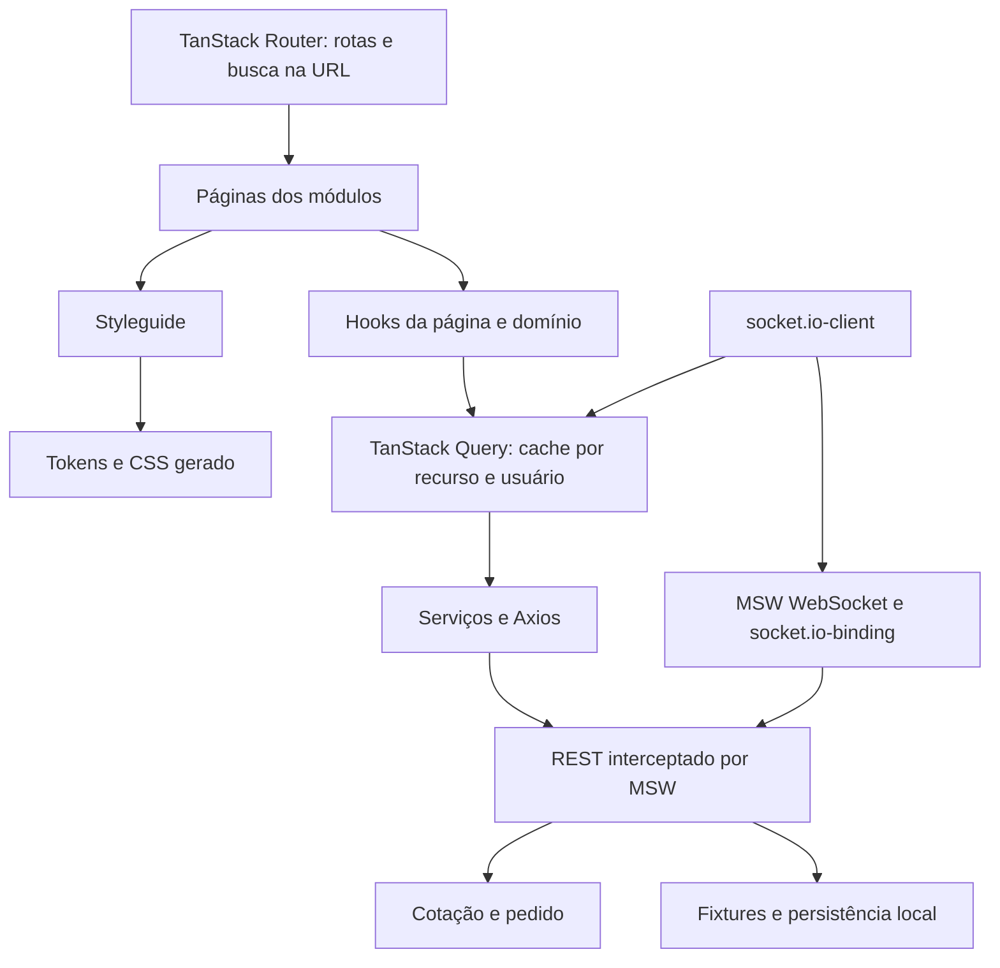
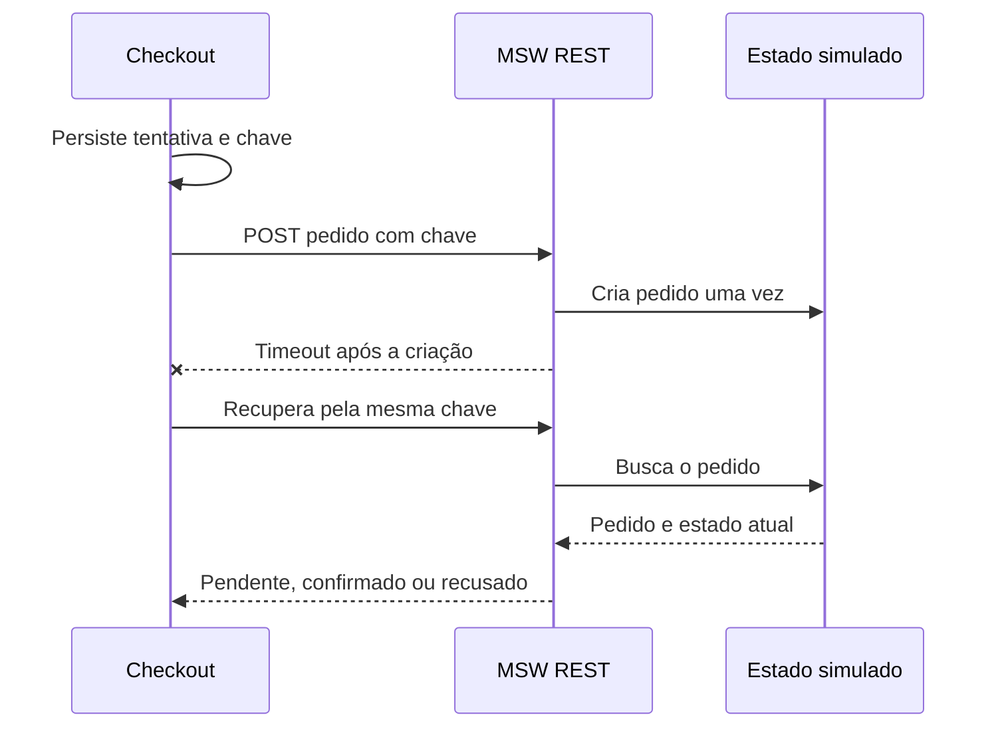

# Arquitetura e decisões

## Organização

React e TypeScript compõem catálogo, conta e compra. A tela chama a API por HTTP e o MSW responde com dados fictícios. Socket.IO recebe mudanças de preço e pedido por WebSocket simulado.

`index.tsx` monta a tela e o hook guarda a lógica. `components` contém o que é reutilizado e `shared-types.ts` reúne os tipos. Os serviços chamam a API com Axios. `contracts.ts` define os dados; `domain` guarda regras sem React. Assim, mudar um cálculo não exige alterar a tela.

`useMarketplace`, `useNftDetails` e `useCartPage` coordenam suas telas. `useCheckoutFields` guarda os campos e `useCheckout` cuida da revisão e recuperação da compra. `useAddToCart` compartilha a inclusão entre card, prévia e detalhe. Componentes como `QuantityInput` e `OrderReceipt` recebem valores e comandos.

## Tema e componentes

O styleguide reúne componentes e tokens: nomes para cores, espaços e tamanhos. Um gerador transforma essas definições em CSS. O `StyleguideProvider` fornece o tema `kurio` por React Context. Uma cor compartilhada muda no token.

Os componentes seguem o shadcn/ui, com Radix e CVA. Diálogos mantêm e devolvem o foco. Campos têm rótulos e erros associados. Skeletons reservam espaço durante a espera. Os estilos ficam próximos dos componentes ou nos templates do tema; o lint impede CSS inline.

TanStack Query guarda as respostas da API e controla sua atualização. Zustand guarda somente o ID da obra aberta na prévia global. Carrinho, sessão, preço e estoque não são copiados para outra store, para evitar duas versões do mesmo dado.

## Contratos REST

As chamadas usam o cliente Axios. Erros retornam `{ message, code }` e o status HTTP. Os tipos estão em [src/contracts.ts](./src/contracts.ts); os schemas em [src/domain/schemas.ts](./src/domain/schemas.ts) conferem os dados recebidos antes do uso.

| Recurso                              | Contrato                                                                                               |
| ------------------------------------ | ------------------------------------------------------------------------------------------------------ |
| `GET /api/nfts`                      | `q`, `category`, `sort`, `page`, `minPrice`, `maxPrice`, `network`, `tab`; itens, paginação e facetas. |
| `GET /api/nfts/:id`                  | Detalhe da obra; 404 para ID inexistente.                                                              |
| `GET /api/recommendations`           | Exclusões e limite; seleção por popularidade fictícia e `simulated: true`.                             |
| `GET /api/articles`                  | Quatro previews ilustrativos do Diário da Cunhagem.                                                    |
| `GET /api/articles/:id`              | Conteúdo demonstrativo; 404 para ID inexistente.                                                       |
| `POST /api/newsletter/subscriptions` | E-mail normalizado; inscrição local idempotente.                                                       |
| `GET /api/session`                   | Usuário público ou `null`.                                                                             |
| `POST /api/session/login`            | E-mail e senha fictícios; sessão e merge do carrinho visitante.                                        |
| `POST /api/session/register`         | Nome, e-mail e senha; conflito para conta existente.                                                   |
| `POST /api/session/logout`           | Encerramento da sessão.                                                                                |
| `GET/POST /api/favorites`            | Consulta e atualização dos favoritos.                                                                  |
| `GET /api/cart`                      | Itens, NFT atual e versão do carrinho.                                                                 |
| `POST /api/cart/items`               | NFT, edição opcional e quantidade inteira.                                                             |
| `PATCH/DELETE /api/cart/items/:id`   | Alteração de quantidade ou remoção.                                                                    |
| `POST /api/quote`                    | Cupom opcional; itens, subtotal, desconto, taxa, total, fingerprint e expiração.                       |
| `POST /api/orders`                   | Cotação, chave de idempotência, carteira, rede e dados fictícios do colecionador.                      |
| `GET /api/orders/:id`                | Estado e snapshot do pedido da sessão.                                                                 |
| `GET /api/orders/attempt/:key`       | Recuperação da tentativa pelo usuário autenticado.                                                     |
| `GET/PATCH /api/profile`             | Consulta e edição do perfil.                                                                           |
| `POST /api/profile/password`         | Senha atual e nova senha da conta fictícia.                                                            |
| `GET/POST /api/wallets`              | Cadastro e edição de carteira, rede e preferência principal.                                           |
| `POST /api/demo/scenario`            | Seleção de cenário de rede ou pagamento.                                                               |
| `POST /api/demo/reset`               | Restauração das fixtures.                                                                              |
| `POST /api/demo/nft-update`          | Alteração de preço e publicação do evento.                                                             |

Recomendações usam popularidade fictícia e excluem os IDs recebidos. O Diário da Cunhagem usa títulos e resumos do layout, com textos ilustrativos. Ambos vêm da API.

A newsletter aceita e-mail de até 160 caracteres. Uma inscrição repetida retorna o mesmo ID e data com `alreadySubscribed: true`. O texto é preservado em falhas. O reset remove as inscrições locais; não há envio de e-mail.

## Valores, edições e compra

Valores em ETH trafegam como strings decimais. Os cálculos usam `BigInt` em wei para evitar arredondamento de ponto flutuante. Quantidades são inteiras, positivas e limitadas pelo estoque.

As edições `one-of-one`, `one-of-ten`, `one-of-fifty` e `open` têm preço e estoque próprios. O carrinho identifica cada variante separadamente. A reserva ocorre uma vez ao criar o pedido; a recusa libera a mesma variante.

A cotação resume os valores calculados pela API e dura cinco minutos. Seu fingerprint identifica usuário, carrinho, edições, redes, preços, versões dos NFTs, cupom e totais. Antes do pedido, o checkout consulta de novo. Uma mudança exige revisão e nova confirmação.

O recibo guarda uma cópia da compra, com preço, quantidade, edição e token. Uma mudança no catálogo não altera um comprovante antigo. A confirmação remove os itens comprados; na recusa, o carrinho permanece.

A tentativa é salva antes do envio. A chave de idempotência identifica a mesma compra: repetir a chave e o conteúdo recupera o pedido existente. Usar a chave com outro conteúdo gera conflito. O mock cria o pedido e reserva o estoque em uma fila local, evitando duas reservas para a mesma tentativa.

## Sessão e cache

O cache do TanStack Query separa as buscas pelos filtros e os dados privados pelo usuário. Uma alteração pede a atualização das consultas relacionadas. O favorito aparece logo após o clique e volta ao estado anterior se a API falhar. O login preserva o carrinho do visitante.

`AbortSignal` permite cancelar a chamada no Axios. Logout, expiração e troca de conta cancelam consultas e limpam o cache privado. Falhas transitórias podem ser repetidas uma vez; erros 4xx não têm repetição automática. Um pedido com resultado incerto é consultado pela chave, em vez de criar outra compra.

A chamada guarda a versão da sessão antes de esperar qualquer resposta. Um marcador local também identifica troca de conta ou reset. Mesmo que o reset repita um número de versão, a resposta antiga é descartada. Recriar apenas a base permite ajustar a versão atual, sem aceitar chamadas de um contexto anterior.

Os hooks conferem quem fez a operação antes do envio e antes de atualizar o cache. Se `sessionStorage` estiver bloqueado, esse controle fica em memória. A simulação restaura sessão e dados após refresh no mesmo navegador.

## Socket.IO e reconciliação

O cliente `socket.io-client` conversa com o WebSocket do MSW por `@mswjs/socket.io-binding`. O caminho `/marketplace-events/` evita o tratamento especial de `/socket.io/` na versão usada. O transporte é somente WebSocket.

| Evento          | Conteúdo e tratamento                                                                                          |
| --------------- | -------------------------------------------------------------------------------------------------------------- |
| `nft.updated`   | Identidade do evento, NFT e versão. Invalida as consultas afetadas para buscar preço e disponibilidade atuais. |
| `order.updated` | Pedido, versão e usuário. Atualiza o acompanhamento sem regredir um pedido confirmado ou recusado.             |

Eventos antigos, duplicados ou de outra sessão são ignorados. A aplicação consulta REST para conferir o estado atual, inclusive após reconectar. Os listeners são removidos ao desmontar ou trocar de usuário.

A biblioteca Socket.IO só é carregada depois de o MSW instalar a interceptação de WebSocket. Os testes de eventos percorrem esse cliente e o binding; os testes REST passam pelos handlers MSW.

## Carregamento e movimento

O bootstrap baixa aplicação e mocks em paralelo. Consultas e Socket.IO esperam `worker.start`. A consulta pública da URL é antecipada com as mesmas `queryOptions` dos hooks; TanStack Query reaproveita essa chamada. A aplicação usa uma única raiz React e carrega as outras páginas quando necessárias.

A fonte Roboto Mono é local. As primeiras imagens têm prioridade; as demais carregam sob demanda, com espaço reservado. `srcSet` e `sizes` escolhem WebP de 360, 600 ou 900 pixels. O destaque mobile também tem 300 pixels.

Os carrosséis usam Embla e `useCarousel`, com setas, indicadores, arraste e teclado. Home e End chegam aos extremos. A navegação é manual, pois o Figma não especifica autoplay. Os controles ficam fora da área que desliza. `prefers-reduced-motion` remove as transições.

## Adaptações do layout

Foram usados os frames e assets do Figma, com Roboto Mono local e conversão das imagens para WebP. A [revisão dos comentários](./docs/figma-comments-review.json) reúne as referências e as decisões de interface.

- Os cards mobile ficam alinhados por linha, com espaço reservado para duas linhas de título. Isso permite comparar títulos e preços sem o deslocamento entre colunas do desenho.
- Perfil, carteiras e recibo receberam layouts mobile seguindo os mesmos componentes, pois não há frames mobile dessas telas no arquivo.
- No carrinho mobile, as linhas do Figma somam 8,14 ETH, mas o subtotal escrito é 8,92 ETH. A aplicação usa a soma calculada pela API.
- As miniaturas da galeria são enquadramentos da mesma arte. A seleção de edição controla preço e estoque separadamente.
- A segunda página do catálogo inclui seis retratos gerados, nos itens 10 a 15. Os primeiros nove itens foram preservados. Prompts, arquivos de origem e variantes estão registrados em [procedência das imagens](./docs/generated-apes-provenance.json).

As medidas e comparações estão nas decisões de [responsividade](./docs/decisions-responsive.md) e [layout mobile](./docs/decisions-mobile-polish.md).

## Persistência e limites da simulação

Base e catálogo têm versões separadas. Atualizar as fixtures preserva contas, carrinhos, favoritos, estoque e recibos. Preços novos invalidam cotações antigas. As imagens dos recibos continuam disponíveis.

Carteiras e pagamentos são fictícios. Os dados ficam no navegador, sem sincronização entre dispositivos. A fila do mock é local. Não há blockchain nem servidor Socket.IO de produção.

OAuth e recuperação de senha ficam indisponíveis. Redes sociais usam links ilustrativos. As contas usam `example.test`, sem credenciais externas.

Comandos, cenários e contas estão no [README](./README.md). Testes, auditorias e análise de performance estão em [verificações de qualidade](./docs/quality-gates.md), incluindo as medições abaixo da meta original do Lighthouse.
