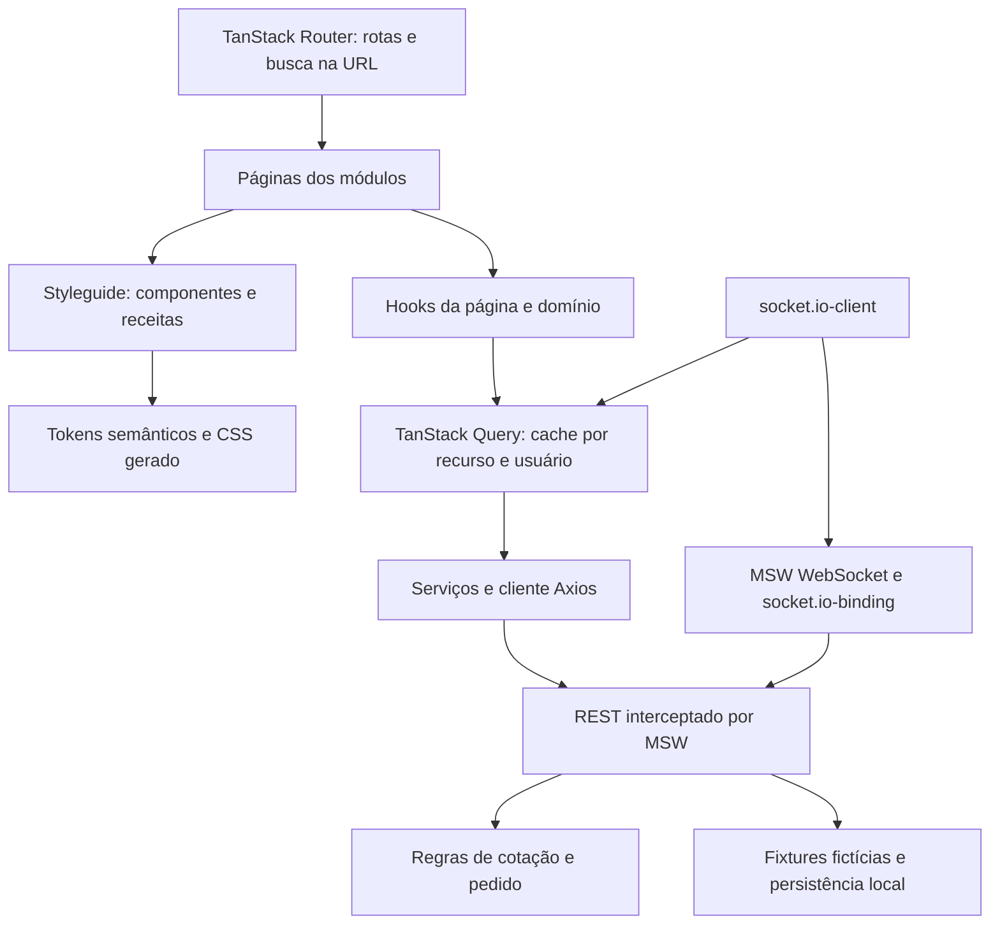
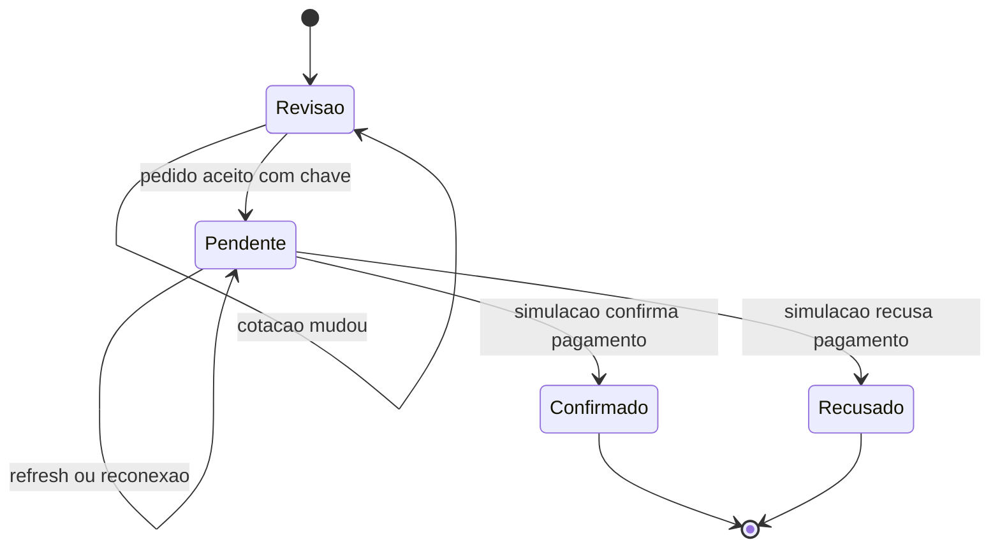
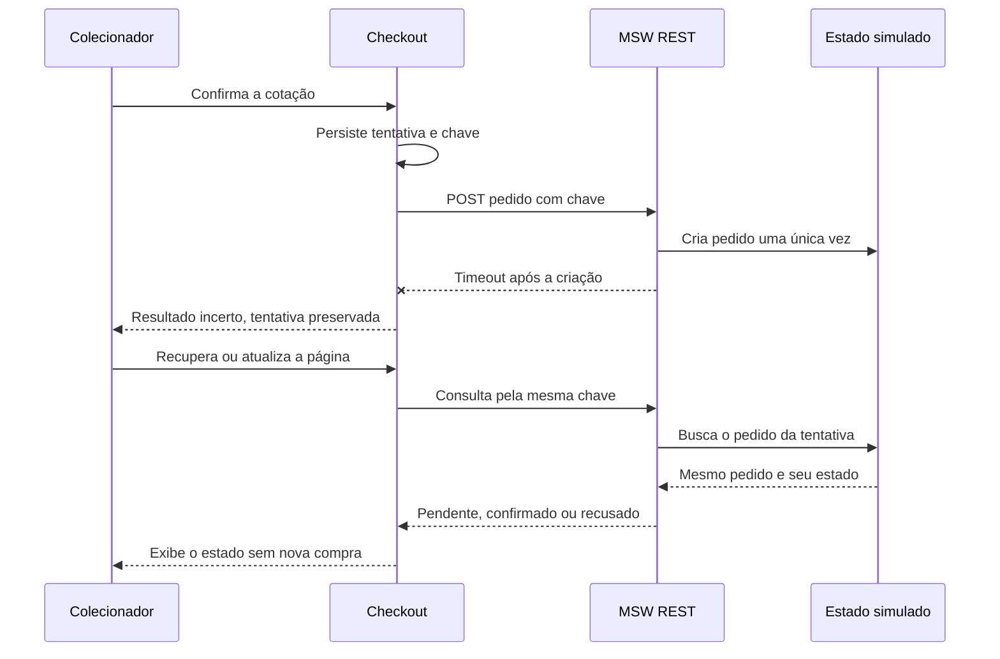

# Arquitetura e decisões

## Objetivo e fronteiras

KURIO é uma aplicação de demonstração para o desafio Jungle. A interface percorre os mesmos contratos HTTP que seriam consumidos de um backend. MSW intercepta essa rede e mantém uma simulação persistente. Nenhum serviço de produção ou dado privado é necessário.

A organização segue a convenção solicitada: `modules/<dominio>/pages/<Pagina>/index.tsx` compõe a tela, o hook próximo da página concentra estado e operações, e `components/<Nome>/index.tsx` contém a apresentação reutilizável. `shared-types.ts` reúne os tipos de composição do módulo; `contracts.ts` define os modelos de transporte. Algumas fachadas em `lib/` e `components/ui/` preservam imports públicos enquanto a implementação é organizada em serviços e styleguide.

## Styleguide

Os tokens definem o vocabulário visual e os aliases semânticos. As receitas definem variações de componentes, como botões. O gerador transforma essa fonte em CSS usado no desenvolvimento e no build; não é necessário transcrever cores em cada tela.

As primitivas seguem o padrão de composição shadcn/ui, com Radix para slots e diálogos e CVA para variantes. Diálogos usam semântica, contenção e retorno de foco da primitiva. Os campos mantêm labels, estados de erro e foco visível. Skeletons reservam dimensões e respeitam movimento reduzido.

### Duas aparências, um contrato visual

`theme/index.ts` define `expedition` e `kurio` com o mesmo contrato de tokens. O gerador emite as variáveis por `data-theme`. O hook `useStyleguide` valida e persiste a preferência e trata falhas de armazenamento. A troca atualiza contexto e atributo do documento sem chave de remontagem, preservando rascunhos, sessão, consultas e tentativa de compra. Alterar a aparência não dispara operações de domínio.

`ThemeSwitcher` usa botões com estado `aria-pressed` e foco visível. O hook próximo do componente fornece opções e ação; as páginas recebem somente a aparência selecionada. O modo Jungle acrescenta `MarketplaceHero` e `CollectionStrip`, ambos de apresentação. Os filtros dessas coleções percorrem o mesmo estado de URL e a mesma consulta REST do catálogo.

## Contratos REST

Todas as chamadas da interface passam pelo cliente Axios. Respostas de erro usam `{ message, code }` e o status HTTP correspondente. O modelo de erro representa validação, sessão expirada, recurso inexistente, conflito de disponibilidade e indisponibilidade transitória.

| Recurso                            | Contrato                                                                           |
| ---------------------------------- | ---------------------------------------------------------------------------------- |
| `GET /api/nfts`                    | `q`, `category`, `sort`, `page`; resposta com `items`, `total`, `page`, `pageSize` |
| `GET /api/nfts/:id`                | Detalhe tipado; 404 para identificador inexistente                                 |
| `GET /api/session`                 | Usuário público ou `null`                                                          |
| `POST /api/session/login`          | E-mail e senha fictícios; sessão e merge do carrinho visitante                     |
| `POST /api/session/register`       | Nome, e-mail e senha; conflito para conta já existente                             |
| `POST /api/session/logout`         | Encerramento da sessão                                                             |
| `GET/POST /api/favorites`          | Leitura e atualização da intenção de favorito                                      |
| `GET /api/cart`                    | Itens, NFT atual e versão do carrinho                                              |
| `POST /api/cart/items`             | Adição de NFT e quantidade inteira                                                 |
| `PATCH/DELETE /api/cart/items/:id` | Alteração de quantidade ou remoção                                                 |
| `POST /api/quote`                  | Cupom opcional; itens, subtotal, desconto, taxa, total, fingerprint e expiração    |
| `POST /api/orders`                 | Cotação, chave de idempotência, carteira, rede e dados fictícios do colecionador   |
| `GET /api/orders/:id`              | Estado e snapshot de um pedido pertencente à sessão                                |
| `GET /api/orders/attempt/:key`     | Recuperação da tentativa pelo usuário autenticado                                  |
| `GET/PATCH /api/profile`           | Leitura e edição dos campos públicos do perfil                                     |
| `POST /api/profile/password`       | Senha atual e nova senha, apenas na simulação                                      |
| `GET/POST /api/wallets`            | Cadastro e edição de carteira, rede e preferência principal                        |
| `POST /api/demo/scenario`          | Seleção de cenário determinístico de rede ou pagamento                             |
| `POST /api/demo/reset`             | Restauração integral das fixtures                                                  |
| `POST /api/demo/nft-update`        | Alteração de preço e publicação do evento correspondente                           |

## Dinheiro, cotação e pedido

Valores ETH são strings decimais no transporte. Os cálculos usam `BigInt` em wei para evitar arredondamento de ponto flutuante. Quantidades são inteiras, positivas e limitadas pelo estoque.

A cotação identifica o usuário, versão do carrinho, itens, preço, versão dos NFTs e cupom em um fingerprint. Ela expira em cinco minutos. O checkout busca uma cotação atual antes de criar o pedido; mudança de fingerprint exige revisão e nova confirmação.

O pedido preserva uma cópia da cotação. O recibo usa essa cópia, e não recalcula preços a partir do catálogo. A confirmação remove somente os itens e quantidades adquiridos. Na recusa, o carrinho permanece e o estoque reservado é liberado.

A tentativa é registrada no navegador antes do envio. Repetir a mesma chave e conteúdo recupera o mesmo pedido; reutilizar a chave para outra intenção gera conflito. A transação da simulação serializa alterações de estoque e criação. Essa fila é local à instância do mock: não substitui restrições transacionais de um backend distribuído.

## Cache, cancelamento e sessão

TanStack Query mantém o estado remoto. Chaves incluem parâmetros do catálogo e identidade do usuário quando o recurso é privado. O catálogo usa stale time curto, e mutations invalidam as projeções relacionadas. Favoritos têm atualização otimista e restauração do snapshot em falha.

Consultas canceláveis propagam `AbortSignal` ao Axios. Logout, expiração e troca de usuário cancelam consultas e removem o cache privado. A fronteira de transporte também valida o contexto da sessão para não aceitar uma resposta privada de uma sessão anterior. A sessão pode ser restaurada depois de refresh.

Mutations de compra não têm retry automático. Isso evita transformar uma falha de comunicação em uma nova intenção de compra. Consultas podem repetir uma falha transitória uma vez; erros 4xx não entram no retry geral.

O armazenamento local é permitido para a demonstração e guarda apenas fixtures e dados introduzidos na própria simulação. Um produto real precisaria de autenticação server-side, política de cookies, proteção de credenciais e persistência transacional próprias.

## Socket.IO e reconciliação

O cliente efetivo é `socket.io-client`. O mock usa WebSocket interceptado pelo MSW e `@mswjs/socket.io-binding` para o protocolo. O caminho é `/marketplace-events/` e o transporte é WebSocket-only. O caminho customizado evita o tratamento especial de `/socket.io/` da versão MSW utilizada.

`nft.updated` carrega identidade do evento, NFT e versão. `order.updated` inclui pedido, versão e usuário. O consumidor verifica o contexto da sessão, ignora versões antigas/duplicadas e não permite regredir pedidos terminais. Eventos invalidam consultas; a resposta REST continua sendo a fonte autoritativa.

A reconexão refaz as consultas dos recursos ativos. O ciclo de vida da conexão remove listeners e desconecta ao desmontar ou trocar de usuário. A biblioteca Socket.IO é carregada depois de o MSW instalar a interceptação de WebSocket.

Limites: não há servidor Socket.IO de produção, salas distribuídas, polling de transporte, blockchain ou sincronização entre dispositivos. A persistência mantém a demonstração após refresh no mesmo navegador. Testes de evento devem atravessar o cliente Socket.IO e o binding, não setters da interface.

## Validação adversarial e evidências

A revisão adversarial verificou transporte real, notificações, consistência de cotação, idempotência, quantidades, isolamento de sessão, dados sensíveis e geometria responsiva. Ela encontrou problemas antes da publicação, incluindo conexão de socket inativa e ausência de anúncio visual da alteração de preço. As correções e verificações pertencem aos relatórios em `reports/`.

| Área do enunciado                                  | Estado da implementação e limite de verificação                                                                     |
| -------------------------------------------------- | ------------------------------------------------------------------------------------------------------------------- |
| React, TypeScript, Router, Query, Axios e REST     | Integrados; confirmar execução final de typecheck, lint e testes                                                    |
| Tailwind, primitivas shadcn/Radix e tema           | Integrados e organizados em styleguide                                                                              |
| Catálogo, busca, filtros, ordem e paginação        | Implementados com parâmetros na URL                                                                                 |
| Detalhe, quantidades e favoritos                   | Implementados; galeria e variantes de edição simplificadas                                                          |
| Carrinho, cupom e refresh/login                    | Implementados; conferir regressões finais de persistência e estoque                                                 |
| Checkout, carteira, revalidação e idempotência     | Implementados com simulação; não realizam transação real                                                            |
| Login, cadastro, perfil, avatar, senha e carteiras | Implementados; segurança de produção não é alegada                                                                  |
| MSW e cenários de rede/erros                       | Integrados na rede e disponíveis no build de demonstração                                                           |
| Socket.IO e atualização do carrinho                | Conexão e atualização real pela simulação verificadas; consultar regressão final do aviso e demais cenários         |
| E2E e regressão visual                             | Suítes e baselines disponíveis; resultados finais e traces devem acompanhar a entrega                               |
| Acessibilidade                                     | Semântica, labels, teclado, foco de diálogos e movimento reduzido implementados; auditoria completa não certificada |
| Responsividade                                     | Estrutura para desktop/tablet/mobile; teste de overflow em 768 px executado; demais resultados nos relatórios       |
| Lighthouse                                         | Script com três medições por página/perfil e mediana; metas dependem dos valores realmente obtidos                  |
| Figma                                              | Referência visual observada; assets substituídos e fidelidade integral não certificada                              |
| Deploy e revisão pública                           | Exigem confirmação da versão publicada e da revisão final; este documento não comprova publicação                   |

## Desvios visuais e privacidade

A restrição do conector Figma impediu exportar os assets oficiais. A referência pública foi observada no navegador, mas a arte incluída foi produzida especificamente para a demonstração em SVG local. Tipografia, paleta e composição foram aproximadas do material observado; não se declara reprodução pixel-perfect.

A entrega não contém dumps, cookies de teste reais, registros de clientes, documentos clínicos, dados financeiros nem credenciais de projetos anteriores. As contas usam o domínio reservado `example.test`. A validação de segredos e do pacote final deve acompanhar a publicação, sem confundir ausência de alerta automático com prova absoluta de ausência de dado sensível.
